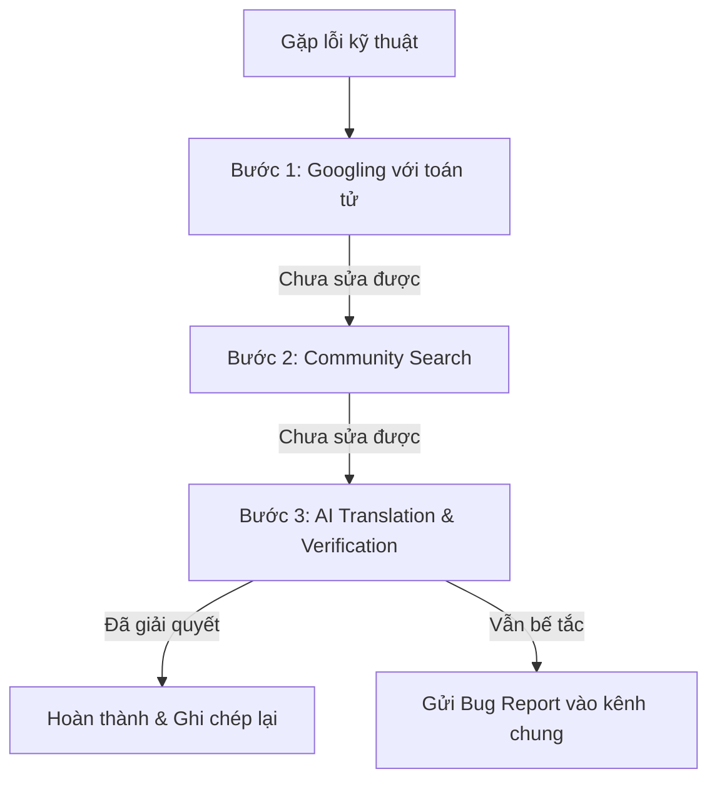

# [D26TXCN02-N]_IT108_[Session 22]_[Bài 5]
**Bài tập: Tối ưu quy trình hỗ trợ kỹ thuật nội bộ**

**Thông tin sinh viên:**
- **Họ và tên:** Lê Hồ Thanh Thảo
- **Mã sinh viên:** N26DTCN030
- **Lớp:** D26TXCN02-N
- **Môn học:** Nhập môn Công nghệ Thông tin (IT_108) 

---

## 1. Thiết kế kiến trúc: Bug Report Template

Để chuẩn hóa quy trình báo lỗi nội bộ, tránh việc các thành viên nhắn tin loạn xạ làm trôi thông tin, toàn bộ thành viên nhóm Startup **bắt buộc phải tuân thủ mẫu báo lỗi (Bug Report Template)** dưới đây trước khi gửi yêu cầu hỗ trợ vào kênh trao đổi chung.

```markdown
### 🐛 [BUG REPORT] - [Tên ngắn gọn của lỗi / Service bị lỗi]

**1. Context (Bối cảnh & Môi trường):**
- **Hệ điều hành (OS):** [Windows 11 / macOS Sonoma / Ubuntu 22.04]
- **Công cụ / Công nghệ liên quan:** [VD: Docker v24.0, Node.js v18.16, Port 8080,...]
- **Thao tác dẫn đến lỗi:** [Mô tả chi tiết 2-3 bước bạn đã thực hiện trước khi gặp lỗi]

**2. Expected (Kết quả kỳ vọng):**
- [Mô tả rõ ràng kết quả đáng lẽ phải xảy ra. Ví dụ: Container Docker chạy thành công và lắng nghe tại port 8080].

**3. Actual (Kết quả thực tế):**
- [Mô tả chính xác điều gì đã xảy ra. Ví dụ: Terminal báo lỗi "Port 8080 already in use" và container tự dừng].

**4. Log & Screenshot (Mã lỗi & Minh chứng):**
- **Đoạn mã lỗi (Error Log):**

  [Dán trực tiếp log lỗi chi tiết dạng text tại đây, không chụp hình mờ]

  Ảnh chụp màn hình (nếu có): [Chèn link ảnh hoặc dán ảnh vào đây]
  ```

Đã thử nghiệm quy trình 3 bước (Tick vào nếu đã làm):

[ ] 1. Googling (Toán tử tìm kiếm)

[ ] 2. Community Search (StackOverflow/GitHub Issues)

[ ] 3. AI Verification (ChatGPT/Gemini)

## 2. Sản phẩm hoàn chỉnh: Quy trình 3 bước tra cứu bắt buộc

Mọi thành viên nhóm phải tự thực hiện **Quy trình 3 bước tra cứu** dưới đây để tự giải quyết **80% vấn đề** trước khi gửi Bug Report nhờ đồng đội hỗ trợ:




